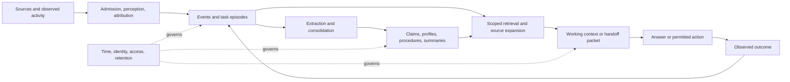

# Architecture taxonomy: from retained evidence to useful continuation

Observation window: **2026-10-12–13**; public-source expansion added **2026-10-13**. This synthesis draws on seven reports: [consumer and coding agents](consumer-and-coding-agents.md), [memory infrastructure](memory-infrastructure.md), [activity capture and handoffs](capture-and-handoffs.md), [papers and evaluation](papers-and-evaluation.md), [Hermes Agent](hermes-agent.md), [Muse, Grok Bot, and counterparts](muse-and-grok-bot.md), and [open-source implementations](open-source-implementations.md). Primary citations below are carried from those reports. No new product testing or benchmark execution is claimed here. Coverage is broad and deliberately nonexhaustive.

## Compare operations and artifacts before products

A useful memory architecture preserves enough evidence to support a later decision while limiting the cost and risk of carrying everything forward. The difficult choices concern **what becomes durable, who may use it, when it becomes visible, how change is represented, and what reaches the next task**. Storage shape alone does not answer those questions.

This proposed decomposition keeps six operations visible:



The source layer and the derived layer are both useful. ReadAgent retains original pages beneath gists; Graphiti links facts to episodes; Hindsight distinguishes retained facts, observations, and standing answers. These support source expansion and revision in different ways, without establishing one universally superior implementation. [ReadAgent](https://arxiv.org/html/2402.09727v3), [Graphiti edge model](https://github.com/getzep/graphiti/blob/0a3b1711b018e5590cf5c44a3ee3e67d6733ee13/graphiti_core/edges.py), [Hindsight observations](https://github.com/vectorize-io/hindsight/blob/f843f173bb41f001e322cc83c917371639e47fbf/hindsight-docs/docs/developer/observations.mdx)

Use these evidence labels throughout the comparison:

| Label | Evidence established by the source report | Limit |
| --- | --- | --- |
| **S** | Relevant public implementation or prompt inspected at a version | Not proof of deployed configuration or measured correctness |
| **D** | First-party documentation states the contract | Hidden scheduler, prompt, ranking, and storage details may remain unknown |
| **P** | Paper body describes a mechanism or experiment | Results are author-reported; artifact reproducibility is separate |
| **I** | Proposed architecture or inference from the documented mechanisms | A testable design choice, not a recovered vendor implementation |
| **U** | The reviewed sources do not establish the detail | Not evidence that the capability is absent |

Openness is independent of these labels. A proprietary product can document behavior precisely; an open repository can leave deployment defaults uncertain. A downloadable binary can run locally without disclosing its source.

## What is being remembered?

The following are engineering categories, not a claim that each product maintains one database per row.

| Memory role | Durable object and typical input | Useful output | Failure to test |
| --- | --- | --- | --- |
| **Session continuity** | Ordered messages, tool results, checkpoints | Resume one ongoing interaction | Confusing a compressed account with the original evidence |
| **Standing instructions** | Human-authored or approved rules, persona, project guidance | Stable prompt constraints | Treating retrieved prose as higher-priority instructions |
| **Personalization** | Preferences, recurring needs, profile fields from conversations | Broadly applicable context for a new request | Promoting a one-off exception or another speaker's preference |
| **Episodic recall** | Source spans, dated events, bounded task/conversation summaries | Recover what happened and reopen detail | Losing qualifiers, artifact revisions, or failed attempts |
| **Semantic/relational memory** | Attributed claims and entity relationships | Current facts, relationship queries, historical questions | Wrong entity merges and temporal contradictions |
| **Procedural memory** | Actions, conditions, results, reusable skills | A candidate method for a related task | Generalizing unverified success or obsolete environment assumptions |
| **Working task state** | Goal, constraints, current artifacts, blockers, next steps | Continuation after interruption or transfer | Mixing planned, attempted, and verified work |
| **Prospective state** | Reminders, standing intents, scheduled jobs | A trigger for future work | Treating a remembered intention as current authorization |
| **Materialized context** | A stored synthesis or answer to a standing question | Cheap, compact context for a recurring need | Serving stale or no-longer-authorized derived content |

These distinctions are grounded in contrasting contracts: SDK sessions persist history; Copilot validates cited repository facts; Voyager retains verified executable skills; Hindsight precomputes mental models. Their objects have different correctness conditions. [Agents SDK sessions](https://openai.github.io/openai-agents-python/sessions/), [Copilot Memory](https://docs.github.com/en/copilot/concepts/agents/copilot-memory), [Voyager](https://arxiv.org/html/2305.16291v2), [Hindsight mental models](https://github.com/vectorize-io/hindsight/blob/f843f173bb41f001e322cc83c917371639e47fbf/hindsight-docs/docs/developer/mental-models.mdx)

## Consumer assistants and agent-owned memory

These rows compare observed contracts. Exact model choices, prompts, scheduler behavior, and ranking remain **U** wherever the cited source does not disclose them. More extensive settings, deployment, and source pins are in the [consumer report](consumer-and-coding-agents.md).

| Surface / role | Inputs and write cadence | Representation, update, retention | Read and continuation output | Evidence |
| --- | --- | --- | --- | --- |
| **ChatGPT personalization** | Conversations and enabled personal sources; saved memories plus background synthesis | Saved facts and history-derived context; deleting a chat need not delete a saved memory | Selective personalization and project-scoped context; detailed production selection remains U | D: [memory](https://help.openai.com/en/articles/8590148-memory-in-chatgpt), [Dreaming](https://openai.com/index/chatgpt-memory-dreaming/) |
| **Claude chat / cloud Cowork** | Current topic memories saved during chat; explicit requests; past-chat search separately | Current topic memory differs from legacy daily summaries; project boundaries, pause and reset controls | Chat continuity and visible past-chat RAG; detailed reconciliation U | D: [chat memory](https://support.claude.com/en/articles/11817273-use-claude-s-chat-search-and-memory-to-build-on-previous-context) |
| **Gemini Apps** | Chats, instructions, enabled connected Google data | Memory and source controls differ; source updates can reach personalization with delay | Personalization and source federation; persistent representation and exact extraction cadence U | D/U: [chat recall](https://support.google.com/gemini/answer/16598469?hl=en), [connected data](https://support.google.com/gemini/answer/16598406?hl=en) |
| **Codex V1 / V2 learned memory** | Eligible idle rollouts selected at later root-session startup; phase-one extraction, then serialized consolidation | V1 handbook + route summary + rollout summaries/skills; V2 compact summary routes directly to rollout summaries. Source deletion and ad-hoc corrections feed consolidation | Bounded injected context followed by targeted file/source lookup; feature/configuration gates matter | S: [pipeline](https://github.com/openai/codex/blob/0c329ad2c9d5a2592128a1d536c66e16f9397e46/codex-rs/memories/README.md), [V2 consolidation](https://github.com/openai/codex/blob/0c329ad2c9d5a2592128a1d536c66e16f9397e46/codex-rs/memories/write/templates/memories/consolidation_v2.md) |
| **Claude Code auto memory** | Agent writes local notes during project work; authored instructions remain separate | Repository-scoped index/topic files, shared across worktrees; survive transcript cleanup until edited/deleted | Bounded index at startup, topic files on demand; subagent memory has configured scope | D: [memory](https://code.claude.com/docs/en/memory), [subagents](https://code.claude.com/docs/en/sub-agents) |
| **Copilot Memory** | Eligible activity produces repository facts and user preferences | Repository facts have code citations; current-checkout validation; unused entries expire after documented retention interval | Cross-surface reuse with different scope for repository facts and personal preferences | D: [memory contract](https://docs.github.com/en/copilot/concepts/agents/copilot-memory) |
| **Cursor Automations** | Scheduled/event-triggered runs can explicitly read/write/delete notes | Per-automation named entries outside the ephemeral working filesystem | Later runs recover workflow context; this differs from project rules and historical editor Memories | D: [automations](https://cursor.com/docs/cloud-agent/automations) |
| **Cline Memory Bank / Rovo Dev reflection** | Configured project documentation updates, or explicit `/memory reflect` | Purpose-specific Markdown, editable with ordinary file tools; no universal expiry or conflict engine established | Fresh-task project context; update cadence is part of the workflow | D: [Cline method](https://docs.cline.bot/best-practices/memory-bank), [Rovo reflection](https://support.atlassian.com/rovo/docs/use-memory-in-rovo-dev-cli/) |
| **Gemini CLI experimental Auto Memory** | Background analysis of eligible inactive sessions; disabled by default | Proposals and skill drafts enter a review inbox; acceptance promotes approved patches to active memory | Reviewed instructions and skills become later context; local artifacts do not imply local inference | D: [Auto Memory](https://geminicli.com/docs/cli/auto-memory/) |
| **OpenClaw Memory Core** | Daily notes, pre-compaction flush, eligible interactive transcripts, background staged consolidation | Curated files plus SQLite provenance/index state; origin gates, supersession, version checks; documented forget-coverage limits | Budgeted bootstrap, hybrid recall, optional recall-agent escalation; conversation visibility remains separate | S/D: [architecture](https://github.com/openclaw/openclaw/blob/45d731e39715aabaf8665f63ca86d7031b3a0b1e/docs/concepts/memory-architecture.md), [provenance](https://github.com/openclaw/openclaw/blob/45d731e39715aabaf8665f63ca86d7031b3a0b1e/docs/concepts/memory-provenance.md) |
| **Open Instinct** | Agent tools append/replace durable notes and daily journals | Simple files; store has no semantic conflict resolver | Fixed-budget durable head plus recent journal tails; audience-scoped injection, not semantic search | S: [memory store](https://github.com/mariagorskikh/open-instinct/blob/79a144a0629833f92f027a8049ab5578cc2f9b39/packages/core/src/memory.ts), [runtime scope](https://github.com/mariagorskikh/open-instinct/blob/79a144a0629833f92f027a8049ab5578cc2f9b39/packages/core/src/runtime.ts) |
| **Meta Muse** | Conversation, enabled app data, browser work, goals and event triggers | Documented cross-conversation context and editable memory files; extraction/schema/ranking U | Continuing work across main/side chats; memory, task state, artifacts, and action permissions have distinct roles | D/U: [launch](https://about.fb.com/news/2026/09/introducing-muse-personal-ai-agent/), [design](https://introducing.muse.ai/), [security](https://research.meta.ai/blog/security-and-safety-for-ai-agents-our-approach-with-muse) |
| **Grok Bot** | Messages, tools, computer work, demonstrations | Documented preferences/work summaries/skills; personal and team context; internal write/ranking machinery U | Bot messages, group transfers, continuing tasks; computer isolation differs from per-Bot memory scope | D/U: [overview](https://docs.x.ai/grok-bot/overview), [team memory](https://docs.x.ai/grok-bot/team-bots) |

The consequential comparison is **where promotion happens**. An automatically extracted candidate, a user-approved note, a consolidation result, and an independently verified procedure are not interchangeable. Gemini CLI's review inbox and OpenClaw's provenance gates make different admission boundaries explicit. Copilot's source check adds a use-time validation boundary. These are separable experiments: evaluate proposal quality, promotion decisions, then downstream utility.

## Public personal-agent implementations expose different mechanisms

The new source audits extend coverage beyond documented closed-product behavior. Hermes is official Nous Research project code; nanoMuse explicitly positions itself as an independent Muse alternative; OpenBot is a comparable bot-team runtime without established Grok lineage; Firstmate supplies instructions for the closed Grok Bot host. OpenMuse and Eidon are independently maintained applications. None discloses Meta's or xAI's private memory engine. Pins, licenses, and inspection limits are recorded in the [Hermes](hermes-agent.md), [Muse/Grok counterparts](muse-and-grok-bot.md#1-identity-affiliation-and-what-is-actually-open), and [implementation](open-source-implementations.md#version-and-license-ledger) reports.

| Public component | Writer and durable state | Reader and lifecycle distinction | Primary evidence |
| --- | --- | --- | --- |
| **Hermes core notes, history, and skills** | Guarded atomic note edits; separate session database and procedural skills; eligible post-turn review can propose changes | Frozen core prompt refreshes at rebuild boundaries; lexical session discovery can expand into source windows. Unattended destructive note edits are staged for review | S: [note store](https://github.com/NousResearch/hermes-agent/blob/ee36aed5adc737db49c94316ffeb97d3fb8dc099/tools/memory_tool_store.py), [write gates](https://github.com/NousResearch/hermes-agent/blob/ee36aed5adc737db49c94316ffeb97d3fb8dc099/tools/memory_tool.py), [session recall](https://github.com/NousResearch/hermes-agent/blob/ee36aed5adc737db49c94316ffeb97d3fb8dc099/tools/session_search_tool.py) |
| **nanoMuse Python memory** | Foreground tools write SQLite facts; ID-based and lexical near-duplicate replacement; bounded model-planned tidying | Newest-1,000 candidate cap, IDF overlap plus recent fill, optional semantic fusion. Undo logs can retain deleted fact text | S: [fact store](https://github.com/nano-muse/nanoMuse/blob/36ba867d516b05058e28df8fbffa0ac888179d69/nanomuse/memory/store.py), [fusion](https://github.com/nano-muse/nanoMuse/blob/36ba867d516b05058e28df8fbffa0ac888179d69/nanomuse/memory/embeddings.py) |
| **OpenBot memory integration** | Completed runs feed a default 30-second delayed reflection batch per bot/thread; durable lessons use a bot-wide namespace | Trigger messages retrieve up to eight lessons; thread recall is separate. Pending reflection timers are in-process, so durable history does not ensure extraction survives a crash | S: [memory integration](https://github.com/regnull/openbot/blob/30d4a6c607fd0aa7f7e90354f516af29b3366747/backend/openbot/runtime/memory.py), [runner](https://github.com/regnull/openbot/blob/30d4a6c607fd0aa7f7e90354f516af29b3366747/backend/openbot/runtime/runner.py) |
| **OpenMuse task context** | Explicit fact records alongside separate task state, evidence, approvals, and receipts | Delegated tasks receive the owner's full fact list. Conversation persistence depends on the separate CopilotKit Intelligence service | S/D: [task reader](https://github.com/CopilotKit/openmuse/blob/1ac68f3909f2478ab6280883f1ab5ea65eb5719d/apps/server/src/engine/model.ts), [service boundary](https://github.com/CopilotKit/openmuse/blob/1ac68f3909f2478ab6280883f1ab5ea65eb5719d/docs/RICH-THREADS.md) |
| **Eidon reviewed personal facts** | Pending CRUD proposals; approval checks the target's captured content/category before destructive changes; global and bot-local facts | All pins plus ten recent and up to 25 semantic additions; small-corpus/full-list fallback differs from top-k-only retrieval | S: [proposals](https://github.com/Quack6765/Eidon-AI/blob/1388ffb85739ae4f396ac98703427b1b478752ec/lib/memory-proposals.ts), [selector](https://github.com/Quack6765/Eidon-AI/blob/1388ffb85739ae4f396ac98703427b1b478752ec/lib/memory-recall.ts), [scope](https://github.com/Quack6765/Eidon-AI/blob/1388ffb85739ae4f396ac98703427b1b478752ec/lib/memories.ts) |
| **nanobot archive and Dream** | Compaction checkpoints enter a cursor journal; scheduled Dream edits profile, project facts, and skills with Git history | Normal completion advances the consumer cursor; processed history can be pruned. Durable memory is agent-workspace-wide, not isolated by selecting a new chat/project | S/D: [store/batching](https://github.com/HKUDS/nanobot/blob/cd2a863710ed4be21ba5426e71321fef6c05ad3d/nanobot/agent/memory.py), [scheduler](https://github.com/HKUDS/nanobot/blob/cd2a863710ed4be21ba5426e71321fef6c05ad3d/nanobot/cli/gateway_runtime.py), [scope](https://github.com/HKUDS/nanobot/blob/cd2a863710ed4be21ba5426e71321fef6c05ad3d/docs/memory.md) |
| **NanoClaw portable concept files** | Agent/human file edits maintain a core index, editable memory definition, and linked concept files | Two bootstrap files, each capped at 16k characters, load at startup/clear/compaction; deeper recall follows links. Resume retains its existing context | S: [reader](https://github.com/nanocoai/nanoclaw/blob/ab09973a8037a2bff568bc169128bfc2104c51ad/container/agent-runner/src/memory/context.ts), [hook](https://github.com/nanocoai/nanoclaw/blob/ab09973a8037a2bff568bc169128bfc2104c51ad/container/agent-runner/src/memory/session-hook.ts) |
| **Firstmate memory policy** | Workers append their own logs; a coordinator maintains shared current-state files and reconciles history | Explicit index/history reads and task-ID handoffs. Writer ownership and verification are prompt instructions, not a separate enforcement engine | S, prompt only: [policy](https://github.com/matteoantoci/firstmate/blob/dc26ad39f5584f23c8408478c6799c2bd69b0a1f/PROMPT.md) |

Three comparison questions become clearer. **Write completion and prompt visibility differ:** Hermes and NanoClaw can retain an older active-context copy after files change. **History retention and learning completion differ:** OpenBot's delayed batch and nanobot's consumption cursor create distinct interruption behavior. **Fact scope and execution authority differ:** Eidon shares global facts with a user's bots, while OpenMuse keeps task approvals separate from personal context. These are source-grounded comparison axes, not claims of measured superiority or interchangeable privacy guarantees. The linked audits describe their limits and proposed experiments.

## Memory engines and processing services

The [infrastructure report](memory-infrastructure.md) contains deeper algorithms, deployment boundaries, and an inspected license ledger. “Current” below means the observed source/documentation version, not every installation.

| System / role | Inputs and write policy | State and lifecycle | Read / task-context interface | Evidence |
| --- | --- | --- | --- | --- |
| **Mem0, historical 2025** | Extract facts, compare nearby memory, choose ADD/UPDATE/DELETE/NOOP | Reconciled fact store; optional graph lineage | Retrieve salient facts for an answer | P: [paper](https://arxiv.org/html/2504.19413v1) |
| **Mem0, current source** | Single-call additive extraction from new/recent messages and similar prior facts | Attributed text records, embeddings, entity links, timestamps, explicit lifecycle APIs | Semantic candidates rescored with keyword/entity signals; do not assume independent-list union | S: [writer](https://github.com/mem0ai/mem0/blob/d26ba5e4518cef7fff3c66d4f715b21adf9feabe/mem0/memory/main.py#L920), [candidate path](https://github.com/mem0ai/mem0/blob/d26ba5e4518cef7fff3c66d4f715b21adf9feabe/mem0/memory/main.py#L1642) |
| **Graphiti** | Episodes from messages/text/JSON; entity and edge resolution at ingestion | Provenance-linked temporal edges; valid and recorded times; invalidation preserves history | Configurable text/vector/traversal recipes and rerankers | S: [ingestion](https://github.com/getzep/graphiti/blob/0a3b1711b018e5590cf5c44a3ee3e67d6733ee13/graphiti_core/graphiti.py), [search recipes](https://github.com/getzep/graphiti/blob/0a3b1711b018e5590cf5c44a3ee3e67d6733ee13/graphiti_core/search/search_config_recipes.py) |
| **Zep managed context** | Episodes, conversations, business data; extraction and summaries/observations | Context Graphs and derived artifacts with source traceability and projected metadata | Prompt-ready Context Blocks and retrieval; full managed implementation differs from Graphiti | D: [context](https://help.getzep.com/v3/retrieving-context), [traceability](https://help.getzep.com/v3/source-traceability) |
| **Current Letta / MemFS** | Agent edits, background dreaming on configured triggers | Git-backed memory; `system/` files pinned; commit/push durability and conflict checks; old revisions require separate deletion treatment | Always-present working set plus file-tree navigation; optional shared repositories | D/S: [memory](https://docs.letta.com/agent-sdk/memory), [repositories](https://docs.letta.com/agent-sdk/repositories) |
| **Hindsight** | Retain contextual facts from text/images/files; background observation consolidation | Source facts → observations → standing mental models; source dependencies and staleness | Hybrid recall or evidence-gathering reflect; standing answers can be read cheaply | D at pinned source: [retain](https://github.com/vectorize-io/hindsight/blob/f843f173bb41f001e322cc83c917371639e47fbf/hindsight-docs/docs/developer/retain.md), [retrieval](https://github.com/vectorize-io/hindsight/blob/f843f173bb41f001e322cc83c917371639e47fbf/hindsight-docs/docs/developer/retrieval.md) |
| **Supermemory** | Conversations, documents, URLs/media; immediate or deferred memory processing | Documents distinct from facts; update/extend/derive links, current-state markers, profiles | Memory/document search, profiles, filesystem view; exact engine internals U | D: [graph memory](https://supermemory.ai/docs/concepts/graph-memory), [processing](https://supermemory.ai/docs/concepts/how-it-works) |
| **Memobase** | Buffered conversational blobs, asynchronous flush, schema-guided profile merge | Profile slots plus dated events/deltas; processed raw blobs deleted by default unless configured otherwise | Whole-profile or query-aware profile selection | S/D: [schema](https://github.com/memodb-io/memobase/blob/358c16bbc6d687937d79bc2f984a11c3be8da901/docs/site/features/profile/profile.mdx), [retention](https://github.com/memodb-io/memobase/blob/358c16bbc6d687937d79bc2f984a11c3be8da901/readme.md) |
| **Cognee** | Configurable ingestion, graph extraction, session improvement | Content/code/session representations; remember/recall/improve/forget; pipeline choices determine semantics | Multiple lexical, vector, graph, temporal, code, and agentic strategies | S/D: [current architecture](https://github.com/topoteretes/cognee/blob/0ec7a9fa61c9ff04bf7e02e0d57af363a993a5e1/README.md) |
| **MemOS** | Configurable memory components; text/images/traces; local experience/dreaming lineages | MemCube can expose text, activation, parametric, preference types; local task layers differ from cloud/core | Facts, task experiences, skills; supported abstraction does not prove every backend runs it | S/D: [MemCube](https://github.com/MemTensor/MemOS/blob/a7367d07e55db61099f7b4e2c1108bc5831a24f3/src/memos/mem_cube/general.py), [local layers](https://github.com/MemTensor/MemOS/blob/a7367d07e55db61099f7b4e2c1108bc5831a24f3/apps/memos-local-plugin/docs/GRANULARITY-AND-MEMORY-LAYERS.md) |
| **ReMe, current** | Session/date cards; changed cards feed incremental background digest consolidation | Markdown/frontmatter/wikilinks; filtered source conversation logs; derived indexes | BM25/link expansion, optional vectors/RRF; line-addressable source context | D at pinned source: [Auto Memory](https://github.com/agentscope-ai/ReMe/blob/749c653f23bbe6791574dd8428fec6c49984574d/docs/en/auto_memory.md), [Auto Dream](https://github.com/agentscope-ai/ReMe/blob/749c653f23bbe6791574dd8428fec6c49984574d/docs/en/auto_dream.md) |
| **memU, current** | Scheduled session jobs; host agent makes extraction/skill judgments | Wiki/skill files committed to a backend; MemoryService handles storage, embedding, retrieval without chat-model calls | Progressive recall from local/cloud backend | S/D: [division of responsibility](https://github.com/NevaMind-AI/memU/blob/166be9041aa4ba545bda84172e841241c7ca09ab/README.md) |

Three trade-offs emerge from these contracts (**I**):

1. **Additive versus destructive revision.** Appending changed claims preserves evidence but requires time/conflict-aware reading. Overwriting a current-state slot simplifies reading but needs history and dependency tracking if historical answers or reversals matter.
2. **Compute during writing versus reading.** Profiles, observations, and standing answers make reads smaller; they create maintenance cost and a freshness problem. Query-time source expansion can recover detail but adds latency and model/tool calls.
3. **Agent-owned files versus service-owned extraction.** Editable files offer familiar inspection/versioning. They still need scope, concurrent-write handling, retention, and admission policy. A service API centralizes some of those decisions but can leave its internal policy uninspectable.

## Frameworks, managed memory, and enterprise retrieval

These layers can be combined. They should not be treated as interchangeable contenders without stating which policy actually runs.

| Layer / examples | What it supplies | What still needs to be specified | Public basis |
| --- | --- | --- | --- |
| **Session/checkpoint persistence:** Agents SDK, LangGraph | Ordered state and recovery across runs | Selection, extraction, cross-session knowledge, identity binding, retention | [SDK sessions](https://openai.github.io/openai-agents-python/sessions/), [LangGraph memory](https://docs.langchain.com/oss/python/concepts/memory) |
| **Policy construction tools:** LangMem, LlamaIndex memory blocks | Extraction/profile tools, bounded chat, fact/vector blocks, background options | Schema, write trigger, promotion rules, backend and prompt placement | [LangMem concepts](https://langchain-ai.github.io/langmem/concepts/conceptual_guide/), [LlamaIndex memory](https://developers.llamaindex.ai/python/framework/module_guides/deploying/agents/memory/) |
| **Adapters/protocols:** Haystack integrations, AutoGen memory, Semantic Kernel vector stores | Composable memory calls and retrieval/context interfaces | Provider policy; an ordered list or vector connector does not autonomously consolidate facts | [Haystack](https://docs.haystack.deepset.ai/reference/integrations-mem0), [AutoGen](https://microsoft.github.io/autogen/stable/user-guide/agentchat-user-guide/memory.html), [Semantic Kernel](https://learn.microsoft.com/en-us/semantic-kernel/concepts/vector-store-connectors/) |
| **Google ADK MemoryService** | Memory interface and recall tools; an in-process example or managed Memory Bank adapter | Actual implementation, persistence, and write policy; the in-process keyword example is not durable memory | [ADK memory](https://adk.dev/sessions/memory/) |
| **Google Memory Bank** | Managed extraction, consolidation, retrieval, identity scopes, revisions and TTL; asynchronous/event-driven options | Application authorization, generation configuration, visibility timing; internals U | [Memory Bank](https://docs.cloud.google.com/gemini-enterprise-agent-platform/scale/memory-bank) |
| **AWS AgentCore Memory** | Events and long-term strategy-derived records; namespaces; published semantic extraction/consolidation prompts | Chosen strategy, event versus record deletion, end-to-end visibility and cost | [Strategies](https://docs.aws.amazon.com/bedrock-agentcore/latest/devguide/memory-strategies.html), [prompt](https://docs.aws.amazon.com/bedrock-agentcore/latest/devguide/memory-system-prompt.html) |
| **Microsoft Foundry memory** | Preview profile, summary, procedural memory with scopes and lifecycle APIs | Preview/deployment limits, model configuration, correct caller scope | [Memory concepts](https://learn.microsoft.com/en-us/azure/foundry/agents/concepts/what-is-memory) |
| **Glean** | Connector-backed enterprise retrieval and a separate user-memory CRUD/schema toolset | Source permissions versus memory ownership; automatic extraction/ranking internals U | [Connectors](https://docs.glean.com/connectors/connectors-power-glean), [memory tools](https://docs.glean.com/administration/platform/mcp/built-in-glean-tools) |
| **Notion AI Enterprise Search** | Source-cited retrieval over workspace and connected apps, permission filtering | Source sync/revocation delay and separate personalization behavior; search docs do not establish a personal-memory extractor | [Enterprise Search](https://www.notion.com/help/enterprise-search), [security/lifecycle](https://www.notion.com/help/enterprise-search-security-and-privacy-practices) |
| **Rovo** | Organization knowledge plus user/site-scoped implicit activity summary and explicit chat instructions | Distinct controls: suggest implicit-summary edits versus directly edit/delete explicit memory | [Memory management](https://support.atlassian.com/rovo/docs/what-is-rovo-memory-management/), [knowledge sources](https://support.atlassian.com/rovo/docs/knowledge-sources-for-agents/) |
| **Salesforce Data 360 / Agentforce** | Extracted facts/preferences/summaries; Unified Individual continuity; governed `GetContext` | Agent/end-user identity and data-space rules; extraction/ranking/deletion internals U | [Memory and context](https://developer.salesforce.com/docs/data/agentic-memory-context/guide/agentic-memory-context-home.html), [governance](https://developer.salesforce.com/docs/data/agentic-memory-context/guide/agentic-memory-governance.html) |

A scope key is an address, not sufficient authorization. Tenant, person, project, task, conversation, agent, and destination may each differ. A personal preference can be relevant to a team task without becoming team-owned knowledge. A recipient may be allowed to read a summary while not being allowed to retrieve every original source; that requires an explicit disclosure policy rather than accidental propagation through a prompt. This is a design inference from the different documented scope contracts.

## Activity capture changes the memory problem

The [capture report](capture-and-handoffs.md) covers additional recorder and meeting products. These examples isolate input differences instead of implying comparable downstream memory engines.

| Input family / example | What enters the pipeline | What can be retained or delivered | Main fidelity boundary |
| --- | --- | --- | --- |
| **Computer observation / Screenpipe** | Accessibility/screen text, OCR fallback, audio, app/input events | Searchable time/app/source-addressable history; context for tools | Seeing text does not establish intent, authorship, or completion. [Search contract](https://docs.screenpipe.com/api-reference/search/search-screen-and-audio-content) |
| **Workflow context / Pieces** | Accumulated work activity | Timeline/conversational memory supplied to other agents through MCP | Public interface does not disclose exact segmentation or ranking. [MCP integration](https://docs.pieces.app/products/mcp/cursor) |
| **Visual archive / Windows Recall** | Opt-in screen snapshots; no audio or continuous video | Local encrypted snapshot retrieval | Snapshot storage/control is not a disclosed preference-learning algorithm. [Privacy/control](https://support.microsoft.com/en-gb/windows/privacy/privacy-and-control-over-your-recall-experience) |
| **Wearable/personal capture / Omi** | Conversations, device/desktop sources | Conversation evidence, separate personal facts and action items; source expansion | Speaker attribution and cloud/model boundaries matter independently of source availability. [Backend](https://docs.omi.me/doc/developer/backend/backend_deepdive), [chat](https://docs.omi.me/doc/developer/backend/chat_system) |
| **Human-guided meeting notes / Granola** | Audio/transcript plus deliberately typed notes | Enhanced notes, cited follow-ups, commitments | Human emphasis is a distinct input; an extracted action item needs support and an owner. [Note workflow](https://www.granola.ai/blog/can-ai-listen-to-a-meeting-and-take-notes) |
| **User-initiated recording / ChatGPT Record** | Audio transcribed into retained notes/transcripts | Later recall and work artifacts | Audio, transcript, derived note, and memory have different retention boundaries. [Record](https://help.openai.com/en/articles/11487532-chatgpt-record) |

For a mixed activity stream, retain **observation → attribution → interpretation → verified outcome** separately (**I**). An assistant assertion that a test passed is not a tool receipt. An open page is not an adopted decision. Repeated screenshots are not independent corroboration. Deduplication, speaker identity, artifact revision, and missing capture intervals belong before semantic memory evaluation.

## Write cadence and read policy are independent axes

“Automatic memory” hides several triggers. A per-turn writer can become visible quickly but repeatedly process low-value text. A later-session job can inspect completed experience but leave a visibility gap. A pre-compaction flush preserves material at a context boundary. A review inbox deliberately delays promotion. A task-outcome writer can use verification evidence but cannot learn before that evidence exists. Codex startup extraction, OpenClaw flush/dreaming, Gemini CLI review, and Voyager skill verification instantiate different choices. [Codex startup](https://github.com/openai/codex/blob/0c329ad2c9d5a2592128a1d536c66e16f9397e46/codex-rs/memories/write/src/start.rs), [OpenClaw flush](https://github.com/openclaw/openclaw/blob/45d731e39715aabaf8665f63ca86d7031b3a0b1e/extensions/memory-core/src/flush-plan.ts), [Gemini CLI](https://geminicli.com/docs/cli/auto-memory/), [Voyager](https://arxiv.org/html/2305.16291v2)

Read policy must be specified separately:

| Read policy | What it buys | What it can miss |
| --- | --- | --- |
| Recent transcript window | Cheap exact local continuity | Old constraints and cross-session relations |
| Always-present profile/core files | No recall query needed for standing context | Rare task-specific detail; prompt cost grows with the core |
| Compact index → episode/source lookup | Small initial context with inspectable expansion | Useful evidence if routing descriptions are poor |
| Lexical/dense/hybrid retrieval | Scales passage or fact selection | Evidence outside the candidate set; exact identifiers need appropriate retrieval |
| Graph traversal | Relations and associative paths | Correctness if entities or edges were misresolved |
| Materialized standing answer | Low read latency and compact synthesis | Changes not yet reflected in the materialized view |
| Reflective/agentic recall | Adaptive multi-step evidence gathering | Unbounded lookup cost or unsupported synthesis without budgets and validation |

The table is an analytical comparison, not measured performance. Candidate generation and ranking are also separate: current Mem0 source semantically gates candidates before lexical/entity rescoring, whereas Graphiti offers fusion recipes. Hindsight separates search-depth budget from response token budget. A label such as “hybrid top-10” therefore does not establish equivalent retrieval or context cost. [Mem0 scoring](https://github.com/mem0ai/mem0/blob/d26ba5e4518cef7fff3c66d4f715b21adf9feabe/mem0/utils/scoring.py), [Graphiti recipes](https://github.com/getzep/graphiti/blob/0a3b1711b018e5590cf5c44a3ee3e67d6733ee13/graphiti_core/search/search_config_recipes.py), [Hindsight retrieval](https://github.com/vectorize-io/hindsight/blob/f843f173bb41f001e322cc83c917371639e47fbf/hindsight-docs/docs/developer/retrieval.md)

## Time, updates, retention, and forgetting

Use at least **event time** and **availability time** in replay. For derived state, also record when the write/consolidation completed and which source prefix it saw. A conversation that occurred Monday but became available Wednesday cannot support a Tuesday query. A later correction may describe what was true Monday while being unknowable on Tuesday. Graphiti's temporal schema is a concrete source example; the replay rule is a proposed evaluation requirement. [Temporal edge fields](https://github.com/getzep/graphiti/blob/0a3b1711b018e5590cf5c44a3ee3e67d6733ee13/graphiti_core/edges.py)

| Operation | Meaning | Required diagnostic |
| --- | --- | --- |
| Context eviction | Remove text from this model invocation | Can permitted source evidence still be retrieved? |
| Relevance decay | Lower selection priority | Is a rare but binding constraint still recoverable? |
| Expiration | Stop using a record after its declared validity/retention rule | Are source, index, and physical-retention semantics separately stated? |
| Supersession | A newer supported claim replaces the current interpretation | Can current and historical-as-known questions both be answered? |
| Retraction | Withdraw a claim without necessarily supplying a replacement | Does the answer become unknown rather than reverting blindly? |
| Source deletion | Remove evidence within a declared deletion scope | Which claims, summaries, skills, views, and exports depend on it? |
| Access revocation | A caller loses permission | Are derived context and caches checked before reuse? |
| Physical erasure | Remove retained payloads from declared stores/copies | Is completion demonstrated for indexes, versions, backups, and exports in scope? |

These are proposed lifecycle distinctions. They prevent calling a low retrieval score “forgetting,” or calling Git file deletion erasure of old revisions. Zep documents source-support-aware deletion; OpenClaw explicitly records limits to tracked provenance; Memobase's default raw-blob disposal reduces later source availability. There is no basis for assuming identical deletion closure across these systems. [Zep traceability](https://help.getzep.com/v3/source-traceability), [OpenClaw provenance](https://github.com/openclaw/openclaw/blob/45d731e39715aabaf8665f63ca86d7031b3a0b1e/docs/concepts/memory-provenance.md), [Memobase retention](https://github.com/memodb-io/memobase/blob/358c16bbc6d687937d79bc2f984a11c3be8da901/readme.md)

## A handoff is a view of task state, not the entire memory

Four outputs should be scored separately: **retrieved evidence**, **a task-context packet**, **control transfer**, and **observed continuation success**. The Agents SDK documents tool-mediated handoffs; MCP supplies tool invocation; A2A exchanges messages, tasks, and artifacts. None defines a universal memory policy or proves that a recipient will complete the task. [SDK handoffs](https://openai.github.io/openai-agents-python/handoffs/), [MCP tools](https://modelcontextprotocol.io/specification/2025-11-25/server/tools), [A2A](https://a2a-protocol.org/latest/specification/)

A proposed packet should contain the objective, current constraints, verified progress, artifact identifiers/revisions, failed attempts, blockers, unresolved questions, suggested next steps with preconditions, source links, knowledge cutoff, destination scope, and current authority. Preserve the difference between an observation, a source assertion, an inference, and a verified outcome. See the [example contracts](papers-and-evaluation.md#generic-handoff-packet-proposed-synthetic) and [capture-to-handoff contract](capture-and-handoffs.md#proposed-task-context-contract).

This suggests a materialized-view design (**I**): build a task packet from permitted sources and projections; record dependencies; invalidate it when evidence, artifacts, or destination permissions change. A profile contributes standing preferences. An episode contributes what was attempted. A procedure contributes a conditional method. Current tool evidence determines whether the next step is still applicable. Copying every memory into the recipient would lose these distinctions and consume its context budget.

## Choosing an architecture by workload

The following are proposed starting points, not vendor rankings. Choose the simplest mechanism that preserves the evidence and lifecycle guarantees the workload needs; expand after diagnosing concrete failures.

| Workload | Start with | Add structure when | Measure |
| --- | --- | --- | --- |
| Resume one interrupted task | Checkpoint/transcript plus current task packet and source access | Transcript is too large, state is scattered, or artifacts changed | First correct action, repeated work, stale-state errors |
| Personalize routine chat | Small scoped profile + explicit preferences + episode evidence | Preferences change with time/context or conflict across sources | Preference correctness, temporary-override handling, unwanted generalization |
| Reuse coding experience | Task summaries, route index, cited code facts, outcome-qualified lessons | Navigation fails or procedures recur with stable preconditions | Repeated failures, source validity, lookup cost, task success |
| Answer historical relationship questions | Attributed claims with valid/known time and source links | Queries require joining people/projects/events beyond passage recall | Entity resolution, current/as-of accuracy, contradiction handling |
| Recall noisy desktop/audio activity | Source-addressable event log, attribution, deduplication, episode boundaries | Flat chunks lose task continuity or source expansion is expensive | Capture/perception errors, episode completeness, unsupported intent claims |
| Produce recurring briefs or task packets | Evidence retrieval plus a versioned materialized view | Read volume justifies maintenance and freshness checks | Refresh lag, dependency invalidation, read cost, citation support |
| Learn reusable procedures | Attempts, feedback, verified outcomes, explicit applicability conditions | Repeated tasks show measurable transfer benefit | Success across environments, negative transfer, rejected-procedure reuse |
| Serve enterprise knowledge | Permission-aware connectors/retrieval plus source versions | User memory or workflow state is needed beyond source documents | Permission/revocation correctness, source freshness, supported answers |
| Support long-lived personal agents | Distinct role, person, team, episode, task, and intent state | Shared agents/tools require stronger audience and concurrency controls | Cross-scope contamination, scheduling correctness, completion cost |

A disciplined selection process has five steps:

1. **Specify the next output.** An answer, reminder, cited brief, coding continuation, and dispatched action need different state.
2. **Describe the evidence channel.** Record actor, modality, source version, uncertainty, audience, arrival delay, and whether outcomes are observed.
3. **Declare lifecycle requirements.** Decide whether historical reconstruction, temporary overrides, source retention, revocation, and physical deletion are required.
4. **Allocate resources across the lifetime.** Charge extraction, indexing, consolidation, retrieval, reader inference, and tool execution; include failed/retried work and background delay.
5. **Use failure-driven escalation.** Add a graph for relation failures, source expansion for compression failures, or procedures for repeated-action failures. Do not add another inference stage solely because a product calls it memory.

Research offers distinct hypotheses for these escalations: Generative Agents combines relevance/recency/importance and reflection; ReadAgent uses gists and source expansion; Reflexion learns advice from feedback; HippoRAG uses associative graph retrieval; model-internal LongMem and MEMORYLLM require different training/inference comparisons. Their reported results are not interchangeable product evidence. [Generative Agents](https://arxiv.org/html/2304.03442v2), [ReadAgent](https://arxiv.org/html/2402.09727v3), [Reflexion](https://arxiv.org/html/2303.11366v4), [HippoRAG](https://arxiv.org/html/2405.14831v3), [LongMem](https://arxiv.org/html/2306.07174v1), [MEMORYLLM](https://arxiv.org/html/2402.04624v2)

## Evidence needed before declaring an improvement

Run a **controlled component track** and a **whole-system track** separately. A common extractor isolates downstream policy; it removes native write-policy differences. A native system measures its entire stack; it needs complete model/configuration/cost accounting. Similarly, fixed chronological replay makes inputs comparable, whereas live continuation measures how actions change future evidence. Both comparisons are useful and answer different questions.

Use benchmark families according to their endpoint. LoCoMo and original/cleaned LongMemEval test conversational recall/reasoning; LongMemEval-V2 separately tests QA over multimodal agent trajectories. PersonaMem emphasizes evolving personalization; MemoryAgentBench includes incremental ingestion and selective forgetting; BEAM stresses long histories; AMA-Bench uses action/observation trajectories but principally scores QA; MemoryArena targets interdependent session tasks. None alone verifies capture fidelity, isolation, deletion closure, calibrated uncertainty, and task completion. Dataset versions and licenses also differ. The [benchmark table](papers-and-evaluation.md#benchmarks-artifacts-and-what-they-actually-test) supplies the primary sources and qualifications.

At minimum, compare no memory, recent history, full authorized history where it fits, tuned lexical/dense/hybrid chunks, summaries with source expansion, and the chosen structured policy. Preserve labels and future data outside the writer's inputs. Report evidence support, temporal correctness, task success, abstention, scope failures, complete context size, maintenance cost, and latency separately. A concise answer with the right fact but the wrong source is not equivalent to supported recall; a polished handoff is not execution success. The [evaluation protocol](papers-and-evaluation.md#reproducible-evaluation-design) provides fixtures and run-manifest requirements.

## Extending the inventory

Add a product **surface and version**, not just a brand name. Separate current documentation, historical papers, public libraries, downloadable binaries, hosted services, and experimental features. A useful inventory card has these fields:

```yaml
system: example-system
surface: specific-memory-feature-or-library
observed_at: YYYY-MM-DD
source_version: commit-or-paper-revision-or-dated-doc
role: [episodic, profile, procedural, task-state]
inputs:
  kinds: [chat, tool-result]
  actor_and_scope: documented-or-unknown
write:
  admission: documented-or-unknown
  trigger: per-turn-or-explicit-or-background-or-reviewed
  extraction_and_promotion: documented-or-unknown
state:
  source_retention: documented-or-unknown
  representation: documented-or-unknown
  provenance_and_time: documented-or-unknown
lifecycle:
  revision_conflict_expiry_delete_revocation: documented-or-unknown
read:
  candidates_ranking_budget: documented-or-unknown
  output: facts-or-profile-or-source-passages-or-task-packet
boundaries:
  owner_audience_destination: documented-or-unknown
  local_cloud_model_calls: documented-or-unknown
  code_binary_service_model_dataset_licenses: separate-artifacts
evidence:
  status: S-or-D-or-P-or-I-or-U
  primary_urls: []
  inspected_component: explicit-boundary
  executed_or_reproduced: false
open_questions: []
```

Use the card as a checklist, not permission to fill gaps by analogy. Open primary pages; inspect relevant source and the actual license where available; preserve public commits and paper versions; attach each material claim to its supporting source. Record contradictions between documents, retirement notices, and incomplete artifact availability. For an update, say which surface changed and which older claim is superseded, rather than retroactively changing a historical paper's mechanism.

Current known limits remain explicit: the reports do not recover closed-service extraction/ranking internals, do not independently reproduce benchmark scores, and do not establish every artifact's complete erasure behavior. Instinct's likely identity is not user-confirmed; MAJOR remains an unresolved research name; similarly named projects and historical renames must not inflate the inventory. The detailed reports retain those uncertainties and the source evidence needed to revise them.
