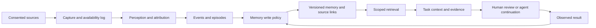

# Activity capture, memory formation, and task handoffs

Public-source research, observed **2026-10-12**, with action-permission sources checked **2026-10-13**. Product behavior below is documented behavior unless a pinned implementation is cited. The reference architecture and experimental recommendations are this survey's synthesis, not claims about a vendor's hidden design.

## Why the input and output belong in the comparison

A memory system fed deliberate chat messages faces a different problem from one fed a microphone, screenshots, application switches, or execution traces. A chat message can express a preference directly. A visible browser page establishes that some content appeared, not that the user believes it. An agent's claim that a deployment succeeded is weaker evidence than the deployment tool's receipt. These distinctions should survive storage and retrieval.

The output differs too. A historical search result, a personalized answer, a reminder, a task-context packet, and a dispatched task are different products. Their success criteria cannot be compressed into one recall score. For example, Omi documents separate conversation-search, personal-fact, action-item, and calendar tools; the architecture separates finding context from changing external state. [Omi chat architecture](https://docs.omi.me/doc/developer/backend/chat_system)



The diagram is a proposed analysis framework. It deliberately preserves the result-feedback edge: a retrieved procedure is a candidate until execution supplies evidence of success or failure.

## Product map

| Product | Memory's role | Inputs | Persistent/retrievable output | Downstream use | Openness and confidence |
| --- | --- | --- | --- | --- | --- |
| Screenpipe | Computer history and workflow context are central | Screen/accessibility data, OCR fallback, audio transcription, input/app events | Searchable local capture history and memory records | MCP context, workflow discovery, scheduled agents | Current repo is **source-available**, not permissive open source; the observed source has a commercial license. [Repository](https://github.com/screenpipe/screenpipe), [pinned license](https://github.com/screenpipe/screenpipe/blob/1455b83b0325570efc98225ec4e866264b869c9d/LICENSE.md) |
| Pieces | Long-term workflow memory is the product | Captured work context; current release docs also describe audio capture | Timeline, workstream summaries, conversational search | Context supplied to coding tools through MCP | Proprietary core; public docs establish interfaces, not complete engine internals. [Desktop](https://docs.pieces.app/products/desktop), [audio release](https://pieces.app/updates/pieces-5-0-3) |
| Windows Recall | OS-level visual recall feature | Opt-in screen snapshots | Encrypted local snapshots and associated search data | Find prior activity and return to source context | Proprietary OS implementation; documented privacy and control surfaces. [Recall controls](https://support.microsoft.com/en-gb/windows/privacy/privacy-and-control-over-your-recall-experience) |
| Omi | Personal assistant built around captured memory | Desktop screen, conversations, phone/wearable inputs | Conversations, extracted personal facts, action items | Chat, reminders, integrations, external tools | MIT repository; source availability does not make the default cloud-backed deployment local-only. [Repository](https://github.com/BasedHardware/omi), [pinned license](https://github.com/BasedHardware/omi/blob/10b7838bae7804dcad36594a1b7649fa83882117/LICENSE) |
| Granola | Meeting work product, with memory across meetings | Device audio plus human-written notes | Transcripts, human notes and generated enhancements | Search across meetings, cited follow-ups, action items | Proprietary; first-party product and security documentation. [Note workflow](https://www.granola.ai/blog/can-ai-listen-to-a-meeting-and-take-notes), [security](https://www.granola.ai/security) |
| Otter | Meeting assistant with a searchable accumulated record | Meeting audio/conversations | Transcription, summaries, action items and meeting knowledge | Meeting agent, follow-up and connected work tools | Proprietary; public feature description is not evidence of its internal memory database. [Product](https://otter.ai/) |
| Plaud | Capture hardware and voice intelligence platform | Recorder/voice audio | Transcription and derived structured outputs | API integrations and downstream applications | Proprietary platform with developer interface; inspect API permissions and job lifecycle separately from device ownership. [Developer overview](https://docs.plaud.ai/overview) |
| Notion AI Meeting Notes | Capture and synthesis inside a larger workspace | Meeting transcription and notes | Workspace pages with notes and transcript context | Workspace search, follow-up and collaborative documentation | Proprietary; workspace access and sharing govern the retained record. [Meeting notes](https://www.notion.com/help/ai-meeting-notes) |
| Khoj | Personal assistant over supplied knowledge | Documents, notes and connected knowledge sources | Searchable personal knowledge and conversation context | Answers, research and automations | Public implementation has an AGPL-3.0 license; hosted terms remain separate. This is deliberate knowledge ingestion, not evidence of continuous desktop observation. [Docs](https://docs.khoj.dev/), [pinned license](https://github.com/khoj-ai/khoj/blob/ae229ca894c0b80ad84664afcfdde523b5e87057/LICENSE) |

For Rewind/Limitless lifecycle and other personal knowledge products, see [memory infrastructure](memory-infrastructure.md). For ChatGPT, coding assistants, Grok Bot, Instinct and related personal agents, see [consumer and coding agents](consumer-and-coding-agents.md). These tables are a bounded landscape sample, not a complete inventory of every recorder, chatbot or meeting service.

## Five input pipelines worth distinguishing

### 1. Computer observation: Screenpipe

The current public search API covers accessibility-first screen text with OCR fallback, audio, input events and memory. Queries can restrict time, app/window, speaker, browser URL and device; results carry capture provenance and pagination. This provides a useful separation between **search over observations** and a generated memory. The API also exposes cloud-search metadata, so local-first does not establish that every possible query path is exclusively local. [Search API](https://docs.screenpipe.com/api-reference/search/search-screen-and-audio-content)

The repository describes event-driven capture and separate optional cloud/sync paths. Its license at observed commit `1455b83b0325570efc98225ec4e866264b869c9d` distinguishes permitted personal/research use from commercial use and explicitly preserves the MIT licensing of earlier MIT-released versions. Official prebuilt releases have separate terms. The current source license must not be retroactively assigned to old revisions, or vice versa. [Repository](https://github.com/screenpipe/screenpipe), [pinned license](https://github.com/screenpipe/screenpipe/blob/1455b83b0325570efc98225ec4e866264b869c9d/LICENSE.md)

**Experimental implication:** retain a source event with its availability time and content identity before making an episode. Measure duplicate observations, capture gaps and app attribution separately from whether a later memory answers a question. An experiment starting from exported text cannot establish screenshot or accessibility capture fidelity.

### 2. Workflow context supplied to another agent: Pieces

Pieces documents a desktop timeline and conversational access to accumulated work history. Its MCP integration requires the local PiecesOS service and an enabled Long-Term Memory engine; an external coding agent uses `ask_pieces_ltm` to request context. This is a concrete example of memory as a product whose output is another product's context. [Desktop](https://docs.pieces.app/products/desktop), [Cursor/MCP integration](https://docs.pieces.app/products/mcp/cursor)

The conversational search documentation describes iterative context gathering and controls for including Long-Term Memory. It does not expose enough implementation detail to derive the exact segmentation model, relevance function or conflict policy. Record those as unknown rather than filling them with an assumed vector database design. [Conversational search](https://docs.pieces.app/products/desktop/conversational-search/using-conversational-search)

**Experimental implication:** evaluate both retrieval and consumption. Give the same task to a fixed downstream coding agent with no memory, raw retrieved material, and a structured context packet. Record whether the agent actually used the retrieved evidence and whether the task outcome improved.

### 3. OS snapshot recall: Windows Recall

Microsoft documents local encrypted snapshot storage, user controls and separation between Windows users. Recall is therefore useful as a reference for a retained observation archive, but those controls do not establish a semantic preference-learning or procedural-memory algorithm. [Recall controls](https://support.microsoft.com/en-gb/windows/privacy/privacy-and-control-over-your-recall-experience)

Recall does not record audio or continuous video. App/site filters and private-browsing support depend on the documented browser capabilities; default sensitive-information filtering is another input-stage policy, not a guarantee that all sensitive meaning is excluded. [Filtering documentation](https://support.microsoft.com/en-us/windows/ai/ai-features/filtering-apps-websites-and-sensitive-information-in-recall)

**Experimental implication:** capture exclusion, retained-data deletion and semantic forgetting require different tests. Preventing a future snapshot is different from deleting an existing snapshot; removing source evidence is different from removing every derived summary or external copy.

### 4. Wearable and multimodal personal memory: Omi

Omi's public repository spans device, mobile, desktop, backend and MCP code under an MIT root license, checked at observed commit `10b7838bae7804dcad36594a1b7649fa83882117`. Its default desktop quick start connects to a cloud backend. That is compatible with open source but different from an entirely local capture-to-inference pipeline. [Repository](https://github.com/BasedHardware/omi), [pinned license](https://github.com/BasedHardware/omi/blob/10b7838bae7804dcad36594a1b7649fa83882117/LICENSE)

The backend documentation distinguishes stored conversations from extracted user facts, action items and calendar-worthy events. It describes Firestore records, vector retrieval, object storage and caching as different responsibilities. The same document explicitly marks its old Deepgram sections historical; the current transcription page identifies Parakeet and Modulate as normal serving defaults, with deployment-specific exceptions. This is a useful example of why a diagram's age and an implementation's version matter. [Backend deep dive](https://docs.omi.me/doc/developer/backend/backend_deepdive), [current transcription](https://docs.omi.me/doc/developer/backend/transcription)

The chat documentation describes routing between no-context, agentic and persona paths. Conversation retrieval can select by date or semantic similarity and request full transcripts when detail is needed. Personal memories use a distinct fact interface; action-item tools change task state. Its described embedding input emphasizes structured conversation content rather than embedding the entire raw transcript. [Chat architecture](https://docs.omi.me/doc/developer/backend/chat_system)

**Experimental implication:** compare a hierarchy of session synopsis → source lookup against flat transcript chunks. Retain speaker identity and confidence across transcription and memory extraction. A noisy diarization decision can turn a colleague's preference into the user's profile; retrieval accuracy alone will not reveal that failure.

### 5. Human-guided meeting memory: Granola

Granola combines typed notes with transcription to create enhanced notes. Human-written cues influence what the generated document emphasizes, so this input is neither purely passive capture nor a conventional chat log. [Note workflow](https://www.granola.ai/blog/can-ai-listen-to-a-meeting-and-take-notes)

Its security page says that stored records are transcript and notes; desktop transcription is real time, while mobile may temporarily cache audio. It identifies external transcription/AI providers and separates private notes from chosen sharing. A local audio source therefore does not imply local model inference or local-only storage. [Security](https://www.granola.ai/security)

Granola describes extracting commitments, owners and dates from transcript context. A generated action item is a proposed interpretation of speech; evaluating it needs source support and attribution, not merely whether the words sound actionable. [Action-item extraction](https://www.granola.ai/blog/meeting-action-items-ai-extraction)

**Experimental implication:** preserve human-authored emphasis as an input channel and test it separately. Compare generic summarization with human-guided synthesis, then score supported commitments, correctly identified owners, missing deadlines and invented obligations.

## What a handoff means

The term has at least four distinct meanings:

| Meaning | What moves | What it does not establish |
| --- | --- | --- |
| Memory retrieval response | Relevant evidence or facts | Correct interpretation or successful action |
| Task-context packet | Objective, constraints, source references, current state | Permission to execute the task |
| Agent control transfer | Responsibility moves to another agent | Persistence across later sessions |
| Durable task/artifact exchange | Task state and outputs cross a protocol boundary | A shared semantic memory or shared authorization domain |

In the OpenAI Agents SDK, handoffs are exposed as model tools. A handoff's argument schema is metadata for the transfer; it does not by itself replace the receiving agent's main input. Input filters and history settings control what conversation state crosses the boundary. This is an orchestration mechanism, not automatically a long-term memory design. [SDK handoffs](https://openai.github.io/openai-agents-python/handoffs/)

MCP standardizes tool discovery and invocation, including structured results. It can carry memory search or write tools, but does not define a universal memory ontology, retention policy or correctness guarantee. [MCP tools](https://modelcontextprotocol.io/specification/2025-11-25/server/tools)

A2A describes agents exchanging messages, tasks and artifacts. The protocol boundary is useful for tracking a continuation's lifecycle; the content and provenance of a memory-informed handoff still need an application-level contract. [A2A specification](https://a2a-protocol.org/latest/specification/)

## Action permissions and delegated authorization

This section separates **D: first-party documented controls**, **U: implementation details not established**, and **I: proposed evaluation hypotheses**. No Muse permission runtime was available for source inspection in this audit, and no account-level product test was performed. The source-inspected independent agents elsewhere in this survey do not establish Muse's implementation. An approval policy is an object of research here, not a settled requirement for another product.

### Muse's documented control boundaries

**D — launch architecture, September 8, 2026.** Meta describes Sentinel outside the agent runtime as the permission authority. Requests identify the connector, method, action class, scope, and user intent; user policy determines permission, refusal, or escalation. Escalation suspends execution and uses a client dialog communicating directly with Sentinel. Conversation text cannot substitute for that decision. Capabilities bind destination and use case; later calls must match. Concrete network requests also pass through Sentinel, with real credentials inserted only after authorization. Some previously authorized or low-risk operations proceed without interruption. These are Meta's architectural claims, not independently verified enforcement properties. [Meta's security and safety account](https://research.meta.ai/blog/security-and-safety-for-ai-agents-our-approach-with-muse)

**D — user-facing scope.** The help page describes possible approvals for one operation, an action type throughout a task, future actions on a site, or future actions through a connector. Available choices depend on the action. Permissions can be reviewed, and site access revoked. Connector settings distinguish asking for all actions from asking for writes and important reads; web settings separately cover unfamiliar sites and potential information sharing. The activity view records actions and permission decisions. Thus remembered authorization is documented state with a scope, not merely a learned preference to avoid interruptions. [Muse guidance and approval](https://www.meta.com/help/artificial-intelligence/1385290430137537/)

**D — platform connectors.** Current developer guidance classifies mixed read/write tools as writes and consequential operations, including purchases and sending email, as sensitive writes. Its permission table is more specific:

| Tool class | Documented platform behavior |
| --- | --- |
| Read | Initially asks; subsequent calls ask unless a revocable remembered grant covers them. |
| Ordinary write | Same default and remembered-grant option. |
| Sensitive write | Approval for every use; no persistent bypass, including saved permissions. |

Connecting an account does not grant every action. Single-use consent binds the presented details; changed price, recipient, or scope requires renewed approval. Its booking example requires a concrete terms summary before approval, a provider-confirmed result before claiming success, and status inspection before retrying an uncertain booking. These are connector requirements and an illustrative workflow, not inspected transactional code. [Connector guidelines, sections 2–3](https://muse.ai/platform/docs)

**D/U — overlapping policy descriptions.** The consumer help page and platform guidelines describe different defaults and scopes. The sources do not provide a complete precedence matrix for built-in versus platform connectors, user overrides, and every grant type. Preserve that uncertainty: neither “all reads run automatically” nor “every tool call always asks” follows from these pages. The platform's sensitive-write restriction is explicit within its documented scope. [Consumer controls](https://www.meta.com/help/artificial-intelligence/1385290430137537/), [platform controls](https://muse.ai/platform/docs)

**D — purchases.** Stripe's September 8 announcement says Muse users approve the total of each Link purchase. Where a merchant does not accept Link directly, the integration issues a virtual card for that approved purchase; Muse does not receive the underlying payment details. This establishes a payment-specific approval boundary. It does not establish one universal policy for every financial-data query, refund, bank transfer, or trading operation. [Stripe's Muse integration announcement](https://stripe.com/newsroom/news/stripe-helps-meta-muse-shop-with-link)

The connector platform currently permits financial-data readers but is not approving new money-transfer or trade-order tools. [Finance connector boundary, section 4.6](https://muse.ai/platform/docs)

### What remains unknown

**U:** the complete risk taxonomy and classifier thresholds; grant serialization; canonicalization or hashing of approved arguments; how an approval binds attachment contents; atomic consumption of single-use grants; the race between revocation and dispatch; retry/idempotency implementation; and audit-log tamper resistance. The documented request boundary and matching guarantee do not reveal those algorithms. The launch article also describes a system at a particular date, not proof that every later connector has identical behavior.

### Evaluation hypotheses, separate from vendor claims

**I:** an experiment can model three independent inputs: **the proposed action**, **current delegated authority**, and **the applicable policy**. Risk affects the policy decision; it does not erase an existing grant. Conversely, a broad goal or a remembered user preference need not satisfy a policy demanding a fresh approval for a specific operation. This framing makes unnecessary interruptions measurable alongside unauthorized execution.

For a handoff experiment, extend the task-context packet with references to authoritative grants and the concrete pending action. Candidate action fields include actor/account, operation, resource or destination, payload identity, price and terms where applicable, task scope, and the state/version checked during preparation. Candidate grant fields include allowed scope, issuer, expiry, revocation, and remaining uses. These fields are **proposed test variables**, not a recovered Muse schema. A receiving agent's permission service would resolve the references; a memory sentence saying “approved” would remain evidence to inspect, not itself a capability.

A proposed control sequence to test is: prepare a reviewable action using currently permitted operations → evaluate existing authorization → ask only if that evaluation requires it → revalidate the actual dispatch against the decision and current state → record the provider result. Exact byte binding, version checks, atomic grant consumption, and idempotency keys are possible implementations to compare, not documented Muse internals. Preparation itself may require authorization when it reads protected data or changes remote state.

| Proposed fixture | Distinction under test |
| --- | --- |
| Summarize records under a valid read grant | Complete covered work without asking again solely because the data concerns money. |
| Read the same records after access is revoked | Relevant remembered facts do not restore permission to fetch the source. |
| Produce a local draft within an authorized workspace | Preparing an artifact and sending or publishing it have different effects. A remote draft save may itself be a write. |
| Repeat an ordinary write under a matching remembered grant | Test both permitted continuation and the cost of needless reapproval. |
| Prepare a purchase under a policy requiring per-transaction consent | The broad shopping objective does not bypass the final approval requirement. |
| Change recipient, attachment contents, or total after approval | Determine whether the selected binding policy detects a different action before dispatch. |
| Hand off to another account, task, site, or agent | Check whether authority transfers under the declared policy; do not infer transfer from shared context. |
| Tool output asserts that the user already approved | Untrusted text cannot mint the permission service's grant. |
| Dispatch times out after the provider may have accepted it | Distinguish an unknown result from a failed operation before allowing a duplicate effect. |

These are candidate evaluation cases, not claimed product test results. Useful outcomes include unauthorized effects, correctly blocked effects, covered actions completed, redundant approval requests, approval-detail mismatch, and duplicate effects after retries. A lower prompt count alone would not establish a better policy, just as a policy that blocks every action would not establish useful delegation.

## Proposed task-context contract

This is a suggested portable design, not a vendor wire format:

```json
{
  "task": "Prepare the next experiment using the verified calibration procedure",
  "scope": {"person": "synthetic-person", "project": "synthetic-project"},
  "knowledge_cutoff": "2026-05-03T10:00:00Z",
  "current_state": [
    {"claim": "The last calibration passed", "source_ids": ["tool-receipt-17"], "status": "observed"}
  ],
  "applicable_procedures": [
    {"memory_id": "procedure-4", "source_ids": ["run-12", "run-17"], "conditions": ["same instrument revision"]}
  ],
  "unknowns": ["Whether the instrument revision has changed"],
  "constraints": ["Do not overwrite prior raw measurements"],
  "requested_output": "A reviewable experiment plan",
  "authorization": {"execute": false}
}
```

The receiver needs enough context to verify applicability, not an entire biography. Source references should resolve to material the receiver is permitted to access. If a source is unavailable or redacted, expose the limitation. A memory item can be relevant yet insufficient to justify a particular action.

## Evaluation across the full chain

The following recommendations are analysis derived from the architectures above and the [paper/benchmark review](papers-and-evaluation.md):

| Layer | Useful measurement | Common false conclusion |
| --- | --- | --- |
| Capture | Coverage, duplicates, missing intervals, permission/filter behavior, resource cost | A clean text replay proves the real capture agent worked |
| Perception | Transcription/OCR error, speaker attribution, source alignment, processing delay | A fluent summary proves the observed evidence was accurate |
| Segmentation | Boundary quality, continuity, task switches, overlap | Fixed time windows are always coherent episodes |
| Memory writing | Groundedness, durable-fact precision, update correctness, contradiction handling | A larger memory archive necessarily retains more useful knowledge |
| Retrieval | Evidence recall and precision at fixed context budgets, temporal and scope correctness | Retrieved source IDs prove every synthesized statement is supported |
| Context packaging | Constraint coverage, provenance, stale information, unresolved questions | A complete-looking handoff is executable or authorized |
| Continuation | Task success, avoidable mistakes, repeated work, time to recover, tool cost | Better question answering guarantees better autonomous work |
| Lifecycle | Deletion propagation, index/cache invalidation, revocation, source retention | Hiding a memory in one UI erases all derived state |

Run controlled interventions. Hold the downstream model and task fixed while changing only the memory policy. Then separately change the capture representation and extraction policy. A shared-extractor comparison isolates storage and retrieval; a native-vendor comparison measures an entire system. Both are useful, but they answer different questions.

Keep event time, processing availability, memory-write time, query time and action time. If a transcription arrives late, a historical query before its arrival must not use it, even if the audio occurred earlier. If a background consolidation has not finished, the next task should see the previous memory state. Measure the cost of producing and maintaining memories across the complete stream, including unsuccessful extraction attempts and discarded candidates.

Finally, preserve separate outcomes for **unknown**, **wrong**, **unsupported**, and **correctly abstained**. A system that invents a confident handoff from absent evidence should not defeat one that accurately reports the gap.
